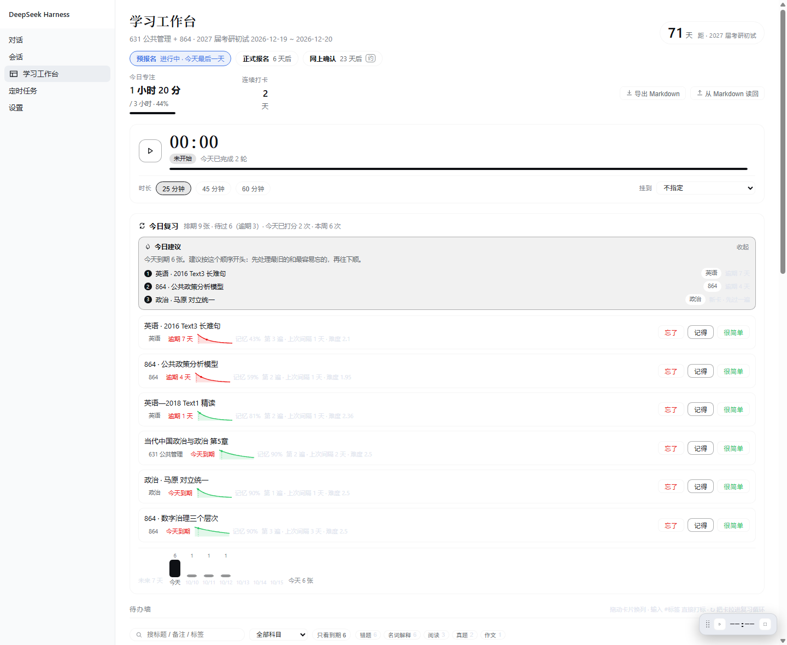
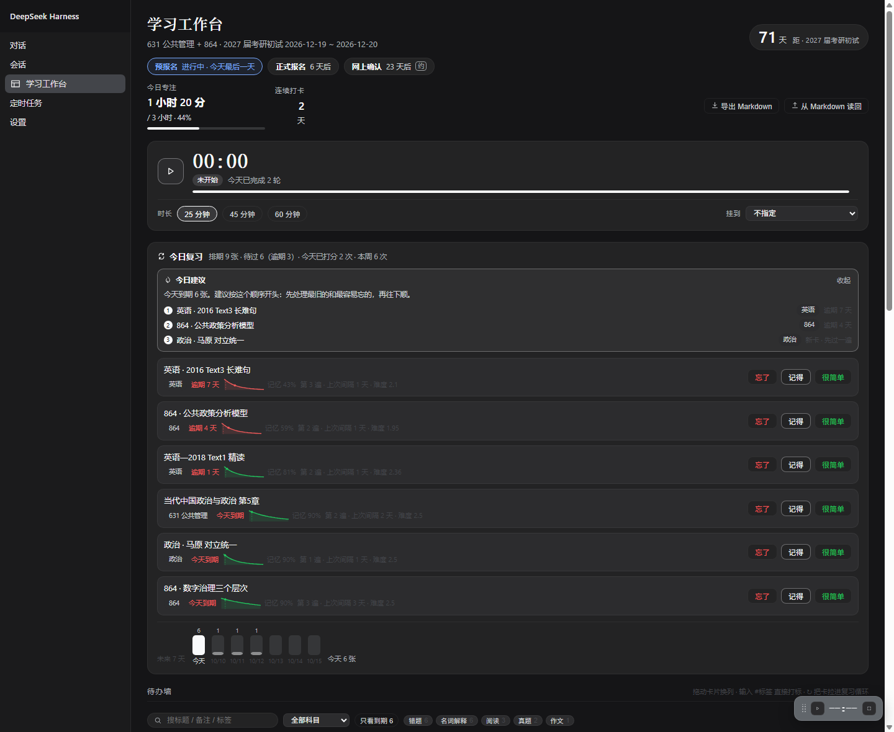

# dsh-study-desk

一个跑在 DeepSeek Harness（DSH）里的学习工作台：待办墙、间隔重复复习、按**实际复习时长**点亮的热力图与周报、番茄钟、每日复盘，外加一个把**不背单词**打卡记录接进来的独立面板。数据是本机一个可读可改可版本化的 JSON，另可导成 Markdown 进 Obsidian。

[](https://www.npmjs.com/package/dsh-study-desk)
[](https://github.com/slow-stack/dsh-study-desk/actions/workflows/ci.yml)
[](LICENSE)
[](package.json)
[](package.json)

适合任何需要**长期投入 + 反复记忆 + 可核对的进度记录**的人：考研考公备考、期末与考证、语言学习、论文与实验推进、组会文献跟踪。

## 为什么是这两块

**热力图按复习分钟点亮，不按「有没有用 AI」。** 市面上同类插件的格子是「当天有没有消耗 token / 有没有开过会话」——那是使用强度，不是学习量。开着窗口摸鱼一天也会亮，这样的图没有诊断价值。这里一格亮不亮，取决于你那天实际专注了多少分钟。

**复习需要排期，不然永远只在做新题。** 卡片可以拉进间隔重复队列，用「忘了 / 记得 / 很简单」三档打分，下次什么时候复习由算法推进（简化版 SM-2：忘了清零留在今晚，记得按难度倍乘，很简单再多拉 30%）。**已完成的卡照样会到期**——背过的东西才是复习的对象。排期之外还有三块：单卡记忆曲线、未来 7 天到期预报、今日建议（见图），所以「今天先过哪几张」不是凭感觉。

## 界面

| 模块 | 干什么 |
| --- | --- |
| 目标与节点 | 右上角一个倒计时（考试 / 答辩 / 投稿都行，名称与日期在设置页填，留空就不显示），下面一排节点 chip：进行中、还剩几天、日期是估的会标「约」 |
| 待办墙 | Notion 式三列（待办 / 进行中 / 已完成），卡片带科目、标签、预计与累计时长，可拖拽换列；顶部一条过滤栏：搜标题 / 备注 / 标签、按科目、按标签、只看到期 |
| 今日复习 | 到期队列摆在最上面，每张卡三个按钮打分；队列长度可调，逾期越久排越前 |
| 记忆曲线 | 每张到期卡带一条迷你曲线 + 「记忆 N%」（`R(t) = e^(-t/S)`，`S` 由排期反推，曲线在排期那天正好落到 90%）。横轴固定 30 天，所以**「稳的卡是近乎水平的线、刚忘过的卡往下掉」是可比的**，一眼挑出最脆的那张 |
| 到期预报 | 未来 7 天每天要过几张（逾期并进今天），用来把复习量摊平，避免某天堆成一堵墙 |
| 今日建议 | 在到期队列之上再排一次顺序，写明理由（逾期几天 / 忘过几次 / 难度偏高 / 新卡），并**按科目轮换**避免连着三张同科。量超过一轮的 1.5 倍时直接劝你顺延，而不是硬扛 |
| 热力图 | GitHub 贡献图那种格子，亮度 = 当天专注分钟数相对每日目标的比例 |
| 周报 | 按周（周一起算）看时长、活跃天数、复习次数与环比，配本周科目分布 |
| 每日复盘 | 一天一条短记录：今天卡在哪、明天第一件事 |
| 番茄钟 | 专注 / 短休 / 长休自动轮换；换面板、刷新、关掉再打开都按绝对截止时间恢复。**起钟要报名字**（手写的名字优先，其次用挂的卡片标题） |
| 番茄分布 | 环形饼图，按番茄的名字聚合时长，可切「今天 / 近 30 天」——一眼看出时间花去哪了（番茄ToDo 那张饼的思路） |
| 单词打卡 | 侧栏第二个面板：连续签到、累计天数与时长、累计词数、逐月打卡日历、正在学的词书与今日计划。数据从本机不背单词 App 的 `shared_prefs` 读，**不登录网页端、不回写 App**，凭据只留前 10 位 |
| 常驻迷你条 | 右下角一个小胶囊，在对话页也能看见剩余时间、今日进度和到期张数。能拖到任意位置并停在原地（松手不再贴边，只会被收回屏幕内），双击回右下角，也能收起成小圆点 |

界面**只消费**宿主的 `--dsw-alias-*` / `--dsw-static-*` 主题 token，不覆写任何 token、不写死任何颜色。换主题（含 catppuccin 之类的 remap）它跟着变，明暗两套都成立。

## 长什么样





> 两张图是用真实组件与示例数据在无头浏览器里渲染的（同一套代码的明暗两套主题），不是某次实际运行的截屏。

## 安装

装进某个 DSH profile：

```bash
node install.mjs --profile <profile 目录>     # 本仓库自带，幂等，会先备份 profile 的 package.json
```

或者手工：在 profile 目录执行 `dsh plugin add dsh-study-desk`，再把包名 `dsh-study-desk` 加进该 profile `package.json` 的 `dsh.profile.bundles` 数组。

装完**新开一个会话**：DSH 的工具表是会话开始时的快照，新增的工具要新会话才会加载。

运行时零依赖，不需要构建，不需要联网。

## 数据

`<DSH_HOME>/study-desk/desk.json` —— 纯 JSON，可以直接打开看、手工改、丢进 git 或 Obsidian vault 做版本。

```
tasks[]     卡片：title / status / subject / note / estimateMin / pinned
            ＋ tags[]（标签）＋ review{due, intervalDays, ease, reps, lapses}（复习排期）
sessions[]  专注记录：热力图与统计的唯一数据源
reviews[]   复习打分记录：复习完成率的唯一数据源
journal{}   按天（YYYY-MM-DD）的复盘文本
timer       当前番茄钟（绝对截止时间戳）
settings    每日目标、专注与休息时长、打卡门槛、复习队列长度、科目表
```

写入走「临时文件 + rename」原子替换；文件坏了会改名留档，**不会清空**。

还可以一键导出成 `desk.md`：按科目分节、`- [ ]` 表状态、笔记是缩进列表，机器字段放在行尾 `<!-- desk:id:… -->` 注释里（Obsidian 阅读模式不显示）。在 vault 里改完再点「从 Markdown 读回」，按 id **合并**而不是覆盖。

## 让模型直接动手

插件给模型一个 `study_desk` 工具（11 个 action），所以你可以直接说「今天该复习什么」「这个我忘了」「把第 3 章拉进复习」「帮我记一下今天的复盘」「最近四周学得怎么样」。

| action | 作用 |
| --- | --- |
| `board` | 看板全貌：距目标日期、今日进度、进行中、待办、今天该复习什么 |
| `add` / `update` / `move` / `remove` | 卡片的增改排删（`add` 支持 `tags` 与 `review`） |
| `review` | 播报今日复习队列；带 `grade=again\|good\|easy` 打分；带 `schedule` / `due` 排期或移出 |
| `focus` | 起停番茄钟 |
| `stats` / `report` | 最近 N 天统计 / 最近 N 周周报 |
| `journal` | 读最近的复盘；带 `text` 写入某天 |
| `bbdc` | 不背单词打卡记录；`refresh=true` 重新采集，`offline=true` 只读本机缓存 |

另外每轮对话会往系统提示里注入一小段「距目标几天 / 今天专注多少 / 进行中是什么 / 今天该复习几张 / 昨天卡在哪」，让模型说话时知道你在哪。不想要就在设置页关掉（省一点上下文）。

## 开发

```bash
node --test             # 48 个单测：数据层、番茄钟状态机、复习排期、Markdown 往返
node apply-probe.mjs    # 离线冒烟：用 stub ctx 把宿主与客户端两侧 apply() 真跑一遍
node install.mjs --check
```

没有构建步骤：宿主半边（`index.js`）与客户端半边（`client.js`）都是手写 ESM。
`desk.js` / `markdown.js` / `timer.js` 是纯函数层，不依赖 DSH 运行时，所以能独立单测。
改完怎么让跑着的 DSH 认、以及三个踩出来的坑与设计约束，都在 [`AGENTS.md`](AGENTS.md) 里。

CI（GitHub Actions）在每次 push / PR 跑单测与冒烟（Node 22、24），并检查 `cordis.patch.yml` 是可移植的裸包名、代码里没有本机绝对路径。npm 发布是**手动触发**的 workflow——发出去的版本删不掉，所以不跟 tag 自动联动。更新记录见 [`CHANGELOG.md`](CHANGELOG.md)。

## 已知限制

- 顶部倒计时与节点（目标名称、日期、`名称 起~止 约` 的节点列表）在设置页里自己填，**留空日期就不显示那一块**。默认值是一份 2027 届考研初试的示例，不是硬编码。
- 间隔重复是简化版 SM-2，不是 Anki 的 FSRS；只有三档打分，没有图片 / 音频卡。
- 单人单机：没有多设备同步，数据就是本机那一个文件（要同步请自己把这个目录交给 git / Syncthing / iCloud）。
- 只在 Windows 上的 DSH 桌面版实测过。宿主半边是纯 Node，客户端半边依赖 DSH 的槽位机制。

## 许可

MIT
